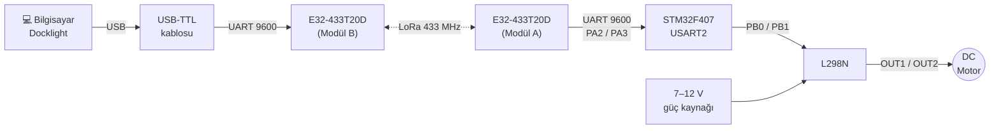

# STM32F407 + EBYTE E32 LoRa ile Uzaktan Motor Kontrolü

Bilgisayardan (Docklight) gönderilen tek harflik komutlar **433 MHz LoRa** üzerinden bir **STM32F407**'ye ulaşır; STM32 de **L298N** sürücüsü ile bir DC motoru **ileri / geri / dur** yapar. Her komuttan sonra STM32 aynı yoldan bir onay mesajı geri yollar.



---

## İçindekiler

1. [Kullanılan malzemeler](#1-kullanılan-malzemeler)
2. [E32 modül ayarları](#2-e32-modül-ayarları)
3. [Bağlantı şemaları](#3-bağlantı-şemaları)
4. [STM32CubeIDE / CubeMX ayarları](#4-stm32cubeide--cubemx-ayarları)
5. [Komutlar](#5-komutlar)
6. [Derleme, yükleme ve test](#6-derleme-yükleme-ve-test)
7. [E32'yi ayar modunda kontrol etme / ayarlama](#7-e32yi-ayar-modunda-kontrol-etme--ayarlama)
8. [Sorun giderme](#8-sorun-giderme)
9. [Notlar ve geliştirme fikirleri](#9-notlar-ve-geliştirme-fikirleri)

---

## 1. Kullanılan malzemeler

| # | Malzeme | Adet | Açıklama |
|---|---|---|---|
| 1 | EBYTE **E32-433T20D** | 2 | SX1278 tabanlı UART LoRa modülü, 410–441 MHz, 20 dBm (100 mW) |
| 2 | **TX433-JKD** anten | 2 | 433 MHz, SMA konnektörlü çubuk anten |
| 3 | **STM32F407** geliştirme kartı | 1 | Kartın üzerindeki ST-Link ile programlanır |
| 4 | **USB-TTL** kablosu | 1 | 6 telli (+5V, GND, RXD, TXD, RTS, CTS); bilgisayar tarafındaki E32 için |
| 5 | **L298N** motor sürücü kartı | 1 | Çift H-köprü, burada yalnızca A kanalı kullanılıyor |
| 6 | DC motor | 1 | L298N'nin OUT1/OUT2 çıkışına bağlı |
| 7 | Motor güç kaynağı | 1 | **7–12 V** adaptör veya pil paketi (9 V kare pil yetersiz kalır) |
| 8 | Jumper kablolar, breadboard | – | Bağlantılar için |
| 9 | Multimetre | 1 | Ölçüm ve sorun giderme için |
| 10 | 3,3 V kaynak (ör. ESP32'nin 3V3 pini) | 1 | Yalnızca E32'yi **ayar modunda** test ederken M0/M1'i HIGH yapmak için |

**Yazılımlar:** STM32CubeIDE, [Docklight](https://docklight.de/) (seri terminal), isteğe bağlı EBYTE [RF Setting](https://www.ebyte.com/pdf-down/1793.html).

---

## 2. E32 modül ayarları

İki modülün **adres, kanal ve hava hızı aynı olmak zorunda**, yoksa birbirlerini duymazlar. Projede iki modül de fabrika ayarında:

```
C0 00 00 1A 17 44
```

| Bayt | Değer | Anlamı |
|---|---|---|
| `C0` | Başlık | Ayarlar kalıcı hafızada |
| `00 00` | Adres | `0x0000` |
| `1A` | Hız | UART **9600 8N1**, hava hızı **2,4 kbps** |
| `17` | Kanal | 23 → 410 + 23 = **433 MHz** |
| `44` | Seçenekler | Şeffaf mod, push-pull IO, FEC açık, **20 dBm** |

Sürüm bilgisi (`C3 C3 C3` cevabı), iki modülde de: `C3 32 10 14` → model `32` (E32, 433 MHz), sürüm `10`.

### Çalışma modları (M0 / M1)

| Mod | M1 | M0 | Ne yapar |
|---|---|---|---|
| 0 – Normal | 0 | 0 | Hem gönderir hem alır — **bu projede kullanılan mod** |
| 1 – Uyandırma | 0 | 1 | Önüne uzun uyandırma sinyali ekleyerek gönderir |
| 2 – Güç tasarrufu | 1 | 0 | Sadece dinler, UART'tan veri almaz |
| 3 – Uyku / ayar | 1 | 1 | Radyo kapalı; `C0`/`C1`/`C3` komutlarına cevap verir |

> ⚠️ M0 ve M1 içeride zayıf pull-up'lıdır; **boşta bırakılırsa HIGH okunur** ve modül normal moddan çıkar. Mutlaka GND'ye (veya GPIO'ya) bağlayın.

---

## 3. Bağlantı şemaları

### 3.1 Bilgisayar tarafı — USB-TTL ↔ E32 (Modül B)

```
   BİLGİSAYAR                USB-TTL KABLOSU                 E32-433T20D (Modül B)
  ┌──────────┐            ┌───────────────────┐             ┌────────────────────┐
  │          │    USB     │ 🔴 +5V   (kırmızı)├────────────►│ VCC                │
  │ Docklight├────────────┤ ⚫ GND   (siyah)  ├──────┬─────►│ GND                │
  │  9600    │            │ ⚪ RXD   (beyaz)  │◄─────┼──────┤ TXD                │
  │  8N1     │            │ 🟢 TXD   (yeşil)  ├──────┼─────►│ RXD                │
  └──────────┘            │ 🟡 RTS   (sarı)   │ boş  ├─────►│ M0                 │
                          │ 🔵 CTS   (mavi)   │ boş  └─────►│ M1                 │
                          └───────────────────┘             │ AUX        (boş)   │
                                                            │ [SMA] ── TX433-JKD │
                                                            └────────────────────┘
```

| USB-TTL | E32 (Modül B) |
|---|---|
| 🔴 +5V | VCC |
| ⚫ GND | GND, **M0**, **M1** |
| ⚪ RXD | TXD *(çapraz)* |
| 🟢 TXD | RXD *(çapraz)* |
| 🟡 RTS, 🔵 CTS | Bağlanmaz |
| – | AUX boş |

> USB-TTL'in lojik seviyesi 3,3 V olmalı (jumper'ı varsa 3V3'e alın). E32'nin RXD/TXD pinleri 3,3 V seviyesindedir.

### 3.2 STM32 tarafı — E32 (Modül A) ↔ STM32F407 ↔ L298N ↔ Motor

```
 E32-433T20D (Modül A)           STM32F407                     L298N                       DC MOTOR
┌────────────────────┐        ┌──────────────┐         ┌────────────────────┐
│ VCC                │◄───────┤ 3V (veya 5V) │         │ IN1                │◄── PB0
│ GND                ├───┬───►│ GND          │◄───┬────┤ GND                │
│ RXD                │◄──┼────┤ PA2 (TX)     │    │    │ IN2                │◄── PB1
│ TXD                ├───┼───►│ PA3 (RX)     │    │    │ ENA  [■ jumper ■]  │      ┌─────┐
│ M0                 │◄──┤    │ PB0 ─────────┼─► IN1   │ OUT1               ├─────►│     │
│ M1                 │◄──┘    │ PB1 ─────────┼─► IN2   │ OUT2               ├─────►│  M  │
│ AUX       (boş)    │        │              │    │    │ +12V               │◄─┐   └─────┘
│ [SMA] ── TX433-JKD │        │  USB (ST-Link)    │    │ 5V   (bağlanmaz)   │  │
└────────────────────┘        └──────┬───────┘    │    └────────────────────┘  │
                                     │            │                            │
                                 Bilgisayar       │     ┌──────────────────┐   │
                              (programlama)       └─────┤ – Güç kaynağı  + ├───┘
                                                        │    7–12 V        │
                                                        └──────────────────┘
```

**E32 (Modül A) ↔ STM32F407**

| E32 | STM32F407 | Not |
|---|---|---|
| VCC | 3V | 5V pini varsa oraya bağlamak daha iyi (tam çıkış gücü) |
| GND | GND | Ortak |
| RXD | **PA2** (USART2_TX) | Çapraz |
| TXD | **PA3** (USART2_RX) | Çapraz |
| M0, M1 | GND | Normal mod |
| AUX | Boş | |

**STM32F407 ↔ L298N ↔ Motor / Güç**

| L298N | Bağlantı | Not |
|---|---|---|
| IN1 | STM32 **PB0** | Yön |
| IN2 | STM32 **PB1** | Yön |
| ENA | **Jumper takılı** (ENA ↔ 5V) | Takılı değilse motor **dönmez** |
| OUT1, OUT2 | Motorun iki ucu | Yön tersse bu iki kablo yer değiştirir |
| +12V | Güç kaynağı **+** | 7–12 V |
| GND | Güç kaynağı **–** ve **STM32 GND** | **GND ortak olmak zorunda** |
| 5V | **Bağlanmaz** | Kartın kendi regülatör çıkışı, STM32'ye verilmez |
| 5V-EN jumper | Takılı kalır | 12 V'a kadar beslemede L298N'nin lojik devresini besler |

### 3.3 L298N doğruluk tablosu

| ENA | IN1 | IN2 | Motor |
|---|---|---|---|
| 1 | 1 | 0 | İleri |
| 1 | 0 | 1 | Geri |
| 1 | 0 | 0 | Dur (fren) |
| 0 / boş | x | x | Çıkış kapalı, motor serbest |

---

## 4. STM32CubeIDE / CubeMX ayarları

Proje **MCU Selector** ile açıldı (Board Selector gereksiz çevre birimleri ekler).

| Ayar | Değer |
|---|---|
| MCU | STM32F407VGTx (kartınızdaki çip) |
| SYS → Debug | **Serial Wire** |
| USART2 | Asynchronous, **9600, 8 bit, None, 1 stop** (PA2/PA3) |
| USART2 → NVIC | **USART2 global interrupt: Enabled** |
| PB0 | GPIO_Output, etiket `MOTOR_IN1` *(koddan da tanımlanabilir, aşağıya bakın)* |
| PB1 | GPIO_Output, etiket `MOTOR_IN2` |
| Saat | Varsayılan (HSI 16 MHz) |

### Kodun yapısı (`Core/Src/main.c`)

Kodun tamamı `USER CODE BEGIN / END` blokları içindedir; CubeMX kodu yeniden oluşturduğunda silinmez.

- **Alım kesmeyle yapılır:** `HAL_UART_Receive_IT()` tek bayt bekler. Bayt gelince `HAL_UART_RxCpltCallback()` onu `komut` değişkenine yazar ve bir sonraki baytı beklemeye başlar. Bir UART hatasında `HAL_UART_ErrorCallback()` alımı yeniden başlatır.
- **Ana döngü** `komut`'a bakar; `F` / `B` / `S`'ye göre motoru sürer ve `yanit()` ile onay gönderir.
- **Yön değişiminde** motor önce 200 ms durdurulur (motoru ve L298N'yi ani ters akımdan korumak için).
- PB0/PB1 CubeMX'te etiketlenmediyse `USER CODE BEGIN PD` içindeki `#ifndef MOTOR_IN1_Pin` bloğu pinleri tanımlar, `USER CODE BEGIN 2` içinde `HAL_GPIO_Init()` ile çıkış yapılır.

---

## 5. Komutlar

Docklight'tan **ASCII** olarak gönderilir (büyük/küçük harf fark etmez):

| Gönder | ASCII | HEX | Motor | STM32'nin cevabı |
|---|---|---|---|---|
| İleri | `F` | `46` | İleri döner | `OK ILERI` |
| Geri | `B` | `42` | Geri döner | `OK GERI` |
| Dur | `S` | `53` | Durur | `OK DUR` |
| Başka harf | – | – | Değişmez | `HATA: F, B veya S gonder` |

STM32 açıldığında bir kez `HAZIR` gönderir. `\r` ve `\n` yok sayılır.

Örnek Docklight çıktısı:

```
[RX] - HAZIR
[TX] - F
[RX] - OK ILERI
[TX] - B
[RX] - OK GERI
[TX] - S
[RX] - OK DUR
```

---

## 6. Derleme, yükleme ve test

1. CubeIDE'de projeyi seçip **Ctrl+B** ile derleyin → `Build Finished. 0 errors`.
2. İlk yüklemede projeye sağ tık → **Run As → STM32 C/C++ Application**. Sonrasında yeşil ▶ yeterli.
3. Bilgisayar tarafında Docklight: modül B'nin COM portu, **9600 8N1, flow control Off**, görünüm **ASCII**, ▶ ile başlatın.
4. Kartın RESET düğmesine basın → Docklight'ta `HAZIR` görünmeli.
5. **Önce motor güç kaynağı takılı değilken** `F`, `B`, `S` gönderip cevapları kontrol edin.
6. Cevaplar doğruysa 7–12 V beslemeyi takın ve motorla deneyin.

> Antenleri **enerji vermeden önce** takın; antensiz gönderim modülü bozabilir. Testte iki modül arasında **en az 1–2 m** olsun; çok yakında alıcı doyuma girer ve paketler bozulur.

---

## 7. E32'yi ayar modunda kontrol etme / ayarlama

Modülün sağlam olup olmadığını ve ayarlarını görmek için (radyo kullanılmaz):

1. **M0 = M1 = 3,3 V**, GND'ler ortak (ör. ESP32'nin 3V3 ve GND pini).
2. Docklight: 9600 8N1, gönderim ve görünüm **HEX** (ASCII'de `C1C1C1` yazmak işe yaramaz).
3. Komutlar:

| Gönder (HEX) | İş | Beklenen cevap |
|---|---|---|
| `C3 C3 C3` | Sürüm oku | `C3 32 xx xx` (4 bayt) |
| `C1 C1 C1` | Ayarları oku | `C0 00 00 1A 17 44` (6 bayt) |
| `C0 00 00 1A 17 44` | Ayarları **kalıcı** yaz | Aynı 6 bayt geri gelir |
| `C4 C4 C4` | Modülü resetle | Cevap yok |

4. `C0` ile yazdıktan sonra **2–3 saniye bekleyin**, sonra enerjiyi kesip açın ve `C1 C1 C1` ile kalıcı olduğunu doğrulayın.
5. Bitince M0 ve M1'i tekrar **GND**'ye alın.

> `C2 ...` ile yazılan ayar **geçicidir**, enerji kesilince kaybolur. Kalıcı ayar için `C0` kullanın.

---

## 8. Sorun giderme

Bu projede karşılaşılan sorunlar ve çözümleri:

| Belirti | Sebep | Çözüm |
|---|---|---|
| İki modül haberleşmiyor | Modüllerden birinin adresi `0x0001` idi | Ayar modunda `C0 00 00 1A 17 44` ile eşitlendi |
| Yazılan adres eski haline döndü | `C0` cevabından hemen sonra enerji kesildi | Yazdıktan sonra 2–3 s bekle, güç döngüsüyle doğrula |
| `C3 C3 C3`'e cevap yok | Komut ASCII olarak gönderildi | Docklight'ta **HEX** seç |
| Normal modda `C3 C3 C3`'e cevap yok | Normal: bu modda komut değil veri olarak karşıya gider | Karşı taraftaki terminale bak |
| Mesaj gitmiyor | M0/M1 boşta veya HIGH | Multimetreyle M0–GND ve M1–GND = **0 V** olmalı |
| Komut cevabı geliyor, motor dönmüyor | **ENA jumper'ı takılı değil** | ENA'nın iki pinini jumper ile birleştir |
| `MOTOR_IN1_GPIO_Port undeclared` | CubeMX etiketi yok / kod yeniden oluşturulmadı | Etiket ver + Ctrl+S, veya pinleri koddan tanımla |
| `implicit declaration of strlen` | `#include <string.h>` eksik | Includes bloğuna ekle |
| "The selection cannot be launched" | Çalıştırma ayarı yok / proje STM32 projesi olarak tanınmıyor | Projeye sağ tık → Run As → STM32 C/C++ Application; gerekirse MCU Selector ile yeni proje |
| `HAZIR` geliyor ama komutlar işlenmiyor | USART2 kesmesi kapalı veya PA3 bağlantısı | NVIC'te USART2 interrupt'ı aç, `stm32f4xx_it.c`'de `USART2_IRQHandler` olmalı |
| Motor çalışınca reset / bozuk mesaj | Motor gürültüsü | Motor uçlarına 100 nF, kısa kablolar, tek noktada GND |

**Genel kontrol listesi:** RX ↔ TX çapraz mı? GND'ler ortak mı? Doğru COM portu mu? Antenler takılı mı?

---

## 9. Notlar ve geliştirme fikirleri

- **Menzil:** EBYTE bu modül için açık alanda ~3 km veriyor. Şehirde dışarıda birkaç yüz metre, bina içinde birkaç on – ~100 m beklenebilir.
- **Hız:** Hava hızı 2,4 kbps; kısa bir komut ~0,1–0,3 s'de karşıya ulaşır. Paket başına en fazla 58 bayt.
- **Yasal güç:** 433 MHz bandında Türkiye/AB'de izin verilen güç genelde **10 mW** civarındadır. Modül 20 dBm (100 mW) ile çalışıyor; sahada kalıcı kullanımda gücü düşürün.
- **Güvenlik:** Bağlantı koparsa motor son komutta kalır. Gerçek kullanımda "X saniye komut gelmezse dur" zaman aşımı eklenmeli.
- **Sonraki adımlar:**
  - ENA'yı PWM pinine bağlayıp hız kontrolü (`H50` → %50 hız gibi)
  - M0/M1 ve AUX'u GPIO'ya bağlayıp modu kodla değiştirme ve AUX ile "modül hazır mı" kontrolü
  - Bilgisayar tarafını ESP32 ile değiştirme
  - Komutlara basit bir sağlama (checksum) ekleme
