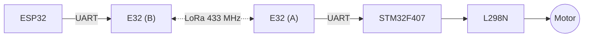

# ESP32 ↔ STM32 LoRa: CRC ve ACK ile Güvenilir Haberleşme

Bu proje, [ESP32 ile LoRa motor kontrolü](../esp32-and-stm32-comm-by-LoRa/README.md) projesinin devamıdır. Donanım ve bağlantılar **aynıdır**; değişen tek şey haberleşmenin kendisidir.

Önceki sürümde ESP32 tek bir harf (`F`, `B`, `S`) gönderiyordu. Bu yöntemin üç zayıf noktası vardı:

1. Harf yolda **bozulursa** (ör. `F` → `G`) STM32 bunu anlayamazdı.
2. Mesaj yolda **kaybolursa** ESP32'nin bundan haberi olmazdı.
3. Gelen bir baytın **gerçek bir komut mu, yoksa parazit mi** olduğu ayırt edilemezdi.

Bu projede her mesaj; başlık, sıra numarası, komut, veri ve **CRC** içeren bir pakete dönüştürüldü. Alıcı her paketi **ACK** (onay) ile cevaplıyor, cevap gelmezse gönderici tekrar deniyor.



---

## İçindekiler

1. [Paket yapısı](#1-paket-yapısı)
2. [CRC nedir, neden kullanıyoruz?](#2-crc-nedir-neden-kullanıyoruz)
3. [Alıcı paketi nasıl tanıyor?](#3-alıcı-paketi-nasıl-tanıyor)
4. [Mesajlaşma nasıl ilerliyor?](#4-mesajlaşma-nasıl-ilerliyor)
5. [Değişken uzunlukta veri](#5-değişken-uzunlukta-veri)
6. [Kod nerede ne yapıyor?](#6-kod-nerede-ne-yapıyor)
7. [ESP32 tarafı](#7-esp32-tarafı)
8. [Docklight ile elle test](#8-docklight-ile-elle-test)

---

## 1. Paket yapısı

Her iki yöndeki paket de **5 bayttır** ve her alan **1 bayt** (0–255) yer kaplar.

### Komut paketi (ESP32 → STM32)

```
  AA      01      01      00      7E
   │       │       │       │       │
başlık    SEQ    komut   veri    CRC
```

| Bayt | Alan | Açıklama |
|---|---|---|
| 0 | Başlık | Her zaman `AA`. "Komut paketi buradan başlıyor" işareti |
| 1 | SEQ | Sıra numarası. Her yeni komutta 1 artar (255'ten sonra 0) |
| 2 | Komut | `01` ileri, `02` geri, `03` dur, `04` sadece durumu sor |
| 3 | Veri | Komuta ek bilgi. Şimdilik `00`; ileride hız (ör. `32` = %50) için kullanılacak |
| 4 | CRC | Bayt 1–3'ün CRC-8'i |

### Onay paketi / ACK (STM32 → ESP32)

```
  55      01      00      01      6C
   │       │       │       │       │
başlık  aynı SEQ  sonuç   motor   CRC
```

| Bayt | Alan | Açıklama |
|---|---|---|
| 0 | Başlık | Her zaman `55`. Komut başlığından farklı ki ikisi karışmasın |
| 1 | SEQ | Onaylanan komutun sıra numarası |
| 2 | Sonuç | `00` = OK, `01` = bilinmeyen komut |
| 3 | Motor durumu | `00` duruyor, `01` ileri, `02` geri |
| 4 | CRC | Bayt 1–3'ün CRC-8'i |

> Aynı sıradaki kutunun anlamı paket türüne göre değişir. Örneğin 3 numaralı bayt, komut paketinde **veri**, ACK paketinde **motor durumu** taşır. Hangi paketin geldiğini ilk bayt (başlık) söyler.

---

## 2. CRC nedir, neden kullanıyoruz?

### Fikir

**CRC (Cyclic Redundancy Check)**, bir verinin yolda bozulup bozulmadığını anlamak için verinin sonuna eklenen küçük bir **parmak izidir**.

1. Gönderen, veriden belirli bir formülle 1 baytlık bir sayı hesaplar ve paketin sonuna ekler.
2. Alıcı, gelen veriden **aynı formülle** bu sayıyı kendisi tekrar hesaplar.
3. İkisini karşılaştırır:
   - **Aynıysa** paket sağlam kabul edilir.
   - **Farklıysa** yolda en az bir bit bozulmuştur; paket atılır.

```
Gönderen:  veri = 01 01 00   →  crc8 = 7E   →  paket: AA 01 01 00 7E
                                                          │
                                                   (yolda parazit)
                                                          ▼
Alıcı:     gelen: AA 01 03 00 7E
           crc8(01 03 00) = 54   ≠  7E   →  PAKET BOZUK, AT
```

Tek bir bitin değişmesi (`01` → `03`) CRC'yi tamamen değiştiriyor. Alıcı bu farkı görünce bozuk paketi uygulamıyor.

### Neden bu projede şart?

Bu sistemde bozulmuş bir paket **motoru yanlış yöne döndürebilir.** Örneğin "ileri" komutu `01`, "geri" komutu `02`. İkisi arasında yalnızca birkaç bit fark var; tek bir parazit bir komutu ötekine çevirebilir. CRC olmadan STM32 bu bozuk komutu sorgusuz uygulardı.

Veri iki farklı yerde bozulabilir:

| Nerede | Neden | Kim yakalar? |
|---|---|---|
| Havada (LoRa) | Uzaklık, duvarlar, başka 433 MHz cihazlar | LoRa radyosunun kendi CRC'si **ve** bizim CRC'miz |
| **Kablolarda (UART)** | Motor gürültüsü, uzun jumper kablolar, gevşek bağlantı | **Sadece bizim CRC'miz** |

LoRa'nın kendi CRC'si yalnızca havadaki kısmı korur. ESP32 ↔ E32 ve E32 ↔ STM32 arasındaki kablolarda oluşan hataları göremez. Motor çalışırken L298N ciddi elektriksel gürültü üretir; bu gürültü en çok UART hattını etkiler. **Bizim CRC'miz ise ESP32'den STM32'ye kadar tüm yolu uçtan uca korur.**

Ayrıca CRC, **parazit baytları gerçek paketlerden ayırır.** Rastgele gelen 5 baytın tesadüfen doğru başlığa ve doğru CRC'ye sahip olma ihtimali çok düşüktür (yaklaşık 1/65 000).

### Neden basit toplama değil de CRC?

En basit yöntem baytları toplamaktır (checksum). Ama toplama, baytların **yeri değiştiğinde** hatayı görmez:

| Veri | Toplam | CRC-8 |
|---|---|---|
| `01 01 00` | 2 | `7E` |
| `01 00 01` (son iki bayt yer değiştirdi) | 2 ← **aynı, hata görülmedi** | `6C` ← **farklı, hata yakalandı** |

CRC, veriyi bir polinoma "bölüp" kalanı aldığı için:
- **Tek bit hatalarını her zaman** yakalar.
- Arka arkaya bozulan bit gruplarını (parazitte en sık görülen hata türü) **8 bite kadar her zaman** yakalar.
- Rastgele, büyük bozulmaları ~%99,6 oranında yakalar (kaçırma ihtimali 1/256).

### Kullandığımız CRC: CRC-8

| Özellik | Değer |
|---|---|
| Uzunluk | 8 bit (1 bayt) |
| Polinom | `0x07` (x⁸ + x² + x + 1) |
| Başlangıç değeri | `0x00` |
| Hesaplanan baytlar | 1, 2, 3 (SEQ, komut, veri). Başlık sabit olduğu için dahil değil |
| Kontrol değeri | `"123456789"` metninin CRC'si = `F4` (standart CRC-8 test değeri) |

```c
uint8_t crc8(const uint8_t *d, size_t n)
{
  uint8_t c = 0x00;
  while (n--) {
    c ^= *d++;                         // sıradaki baytı kat
    for (uint8_t i = 0; i < 8; i++)    // 8 bit boyunca "böl"
      c = (c & 0x80) ? (uint8_t)((c << 1) ^ 0x07)   // en üst bit 1 ise polinomla XOR
                     : (uint8_t)(c << 1);          // değilse sadece kaydır
  }
  return c;
}
```

**İki tarafta da birebir aynı fonksiyon olmak zorundadır.** Farklı bir polinom ya da başlangıç değeri kullanılırsa her paket "bozuk" sayılır.

### CRC boyutu nasıl seçilir?

| CRC | Boyut | Tipik kullanım |
|---|---|---|
| **CRC-8** | 1 bayt | Kısa komut paketleri (bizim durumumuz), sensörler, SMBus |
| CRC-16 | 2 bayt | Modbus RTU, USB, birçok seri protokol |
| CRC-32 | 4 bayt | Ethernet, WiFi, ZIP, PNG |

Kural: **paket uzadıkça ve hatanın bedeli büyüdükçe CRC de uzar.** 3 baytlık veri için CRC-8 yeterlidir; paketler 20–30 baytı geçerse CRC-16'ya geçmek mantıklı olur.

### CRC'nin yapamadıkları

- **Hatayı düzeltmez, sadece bulur.** Düzeltme işini ACK + tekrar gönderme yapar (bölüm 4).
- **Güvenlik sağlamaz.** Kazara bozulmaya karşıdır. Kötü niyetli biri paketi değiştirip CRC'yi de yeniden hesaplayabilir. Buna karşı şifreleme veya imza (AES, HMAC) gerekir.

---

## 3. Alıcı paketi nasıl tanıyor?

UART üzerinden sürekli bir **bayt akışı** gelir. Bu akışta paketin nerede başlayıp nerede bittiği yazmaz. Alıcı bunu bir **durum makinesi** ile çözer:

```
                ┌──────────────────────────────────┐
                ▼                                  │
     ┌─────────────────────┐   AA değil            │
     │ 1. Başlık bekle     │ ─────────► baytı at ──┘
     └─────────┬───────────┘
               │ AA geldi
               ▼
     ┌─────────────────────┐   100 ms sessizlik
     │ 2. 4 bayt daha topla│ ─────────► yarım paketi at → 1
     └─────────┬───────────┘
               │ 5 bayt tamam
               ▼
     ┌─────────────────────┐   tutmuyor
     │ 3. CRC kontrol      │ ─────────► paketi at, cevap verme → 1
     └─────────┬───────────┘
               │ doğru
               ▼
     ┌─────────────────────┐   aynı SEQ
     │ 4. SEQ kontrol      │ ─────────► komutu uygulama, sadece ACK'yi tekrarla → 1
     └─────────┬───────────┘
               │ yeni SEQ
               ▼
     ┌─────────────────────┐
     │ 5. Komutu uygula    │
     │    ACK gönder       │ ─────────► 1
     └─────────────────────┘
```

Bu yapıyı sağlam yapan üç kural:

| Kural | Neye karşı korur |
|---|---|
| **Başlık (`AA`) gelene kadar her şeyi atla** | Araya giren çöp baytlar. Akış nereden başlarsa başlasın, bir sonraki `AA`'da kendini toparlar |
| **100 ms içinde paket tamamlanmazsa at** | Yarım kalan paketler. Kopan bir paket bir sonrakini bozmaz |
| **CRC tutmazsa at** | Bozulmuş paketler ve tesadüfen `AA` ile başlayan parazitler |

**Örnek:** araya bir çöp bayt (`37`) girmiş bir akış:

```
Gelen akış:  37  AA 02 02 00 FC
             │   └──── paket ────┘
             └─ AA değil → atıldı
Sonuç: "geri" komutu doğru şekilde işlendi.
```

ESP32 de ACK'leri aynı yöntemle çözer; tek fark başlığın `55` olmasıdır.

---

## 4. Mesajlaşma nasıl ilerliyor?

### Normal durum

```
ESP32                                          STM32
  │                                              │
  │──── AA 01 01 00 7E  (seq 1: ileri) ─────────►│  CRC ✓, yeni SEQ
  │                                              │  motor → İLERİ
  │◄─── 55 01 00 01 6C  (seq 1: OK, ileri) ──────│
  │                                              │
  [ACK] seq=1 OK motor=ILERI sure=410 ms deneme=1
```

### Komut yolda kaybolursa

```
ESP32                                          STM32
  │──── AA 02 02 00 FC  (seq 2: geri) ───X       │  (hiç ulaşmadı)
  │      ... 1 saniye ACK gelmedi ...            │
  │──── AA 02 02 00 FC  (aynı paket, 2. deneme) ►│  CRC ✓, yeni SEQ → GERİ
  │◄─── 55 02 00 02 D8 ──────────────────────────│
  │
  [ZAMAN ASIMI] seq=2 deneme 1/3
  [ACK] seq=2 OK motor=GERI deneme=2
```

### ACK dönüşte kaybolursa (sıra numarasının asıl işi)

```
ESP32                                          STM32
  │──── AA 03 03 00 82  (seq 3: dur) ───────────►│  motor → DUR
  │                     X───── 55 03 00 00 BD ───│  (ACK kayboldu)
  │      ... 1 saniye ACK gelmedi ...            │
  │──── AA 03 03 00 82  (2. deneme) ────────────►│  SEQ 3 zaten işlendi!
  │                                              │  komutu TEKRAR UYGULAMA
  │◄─── 55 03 00 00 BD  (ACK tekrarı) ───────────│  sadece ACK'yi tekrarla
```

STM32 aynı SEQ'yu ikinci kez gördüğünde komutu yeniden uygulamaz. "Dur" için bu fark etmez; ama ileride "motoru 1 tur çevir" gibi bir komutta, komutun iki kez uygulanmasını (motorun 2 tur dönmesini) engeller.

### Bozuk paket gelirse

STM32 CRC'si tutmayan pakete **hiç cevap vermez.** ESP32 ACK alamayınca paketi zaten tekrar gönderir. Ayrı bir "bozuk geldi" (NACK) mesajına gerek kalmaz.

### Hiçbir deneme tutmazsa

ESP32 en fazla **3 kez** dener (toplam ~3 saniye). Hiçbirine ACK gelmezse `[BASARISIZ]` yazar. Komut ulaşmamış olabilir; ama en azından bunu **kesin olarak bilirsin**. Eski tek harfli sistemde bunu bilmenin yolu yoktu.

### Sıra numarası neden rastgele başlıyor?

ESP32 her açılışta SEQ'ya rastgele bir değerle başlar (`esp_random()`). Hep 1'den başlasaydı, ESP32 yeniden başladıktan sonra gönderdiği ilk komut, STM32'nin hatırladığı son SEQ ile aynı olabilirdi; STM32 bunu "tekrar" sanıp uygulamazdı.

---

## 5. Değişken uzunlukta veri

Paket şu an **sabit 5 bayt**, çünkü motor komutu için bu kadarı yetiyor. Bu bizim seçimimiz, bir zorunluluk değil. Gerçek sınırı E32 koyar: **tek radyo paketinde en fazla 58 bayt.**

Farklı uzunlukta veri göndermek gerekirse (ör. sensör değerleri) pakete bir **uzunluk (LEN)** alanı eklenir:

```
[AA] [SEQ] [CMD] [LEN] [VERİ ... LEN bayt] [CRC]
```

| Paket | Anlamı |
|---|---|
| `AA 05 03 00 xx` | Dur (veri yok) |
| `AA 06 01 01 32 xx` | %50 hızla ileri (1 bayt veri) |
| `AA 07 10 04 1A 2B 3C 4D xx` | 4 baytlık sensör verisi |

Alıcı önce LEN'i okur, ardından o kadar bayt daha bekler, en son CRC'yi kontrol eder. Bu yapıya **TLV (Type-Length-Value)** denir. Bu durumda CRC, LEN ve verinin tamamı üzerinden hesaplanır; paket uzadığı için CRC-16'ya geçmek de düşünülebilir.

> Bu projedeki yaklaşım, endüstride kullanılan protokollerin temel fikirlerini taşır: **Modbus RTU** (adres + fonksiyon + veri + CRC-16), **MAVLink** (başlık + uzunluk + sıra no + mesaj türü + CRC). İki cihazın kodunu da kendimiz yazdığımız için daha basit, kendi protokolümüzü kullandık.

---

## 6. Kod nerede ne yapıyor?

| Görev | STM32 (`main.c`) | ESP32 (`.ino`) |
|---|---|---|
| CRC hesaplama | `crc8()` | `crc8()` (birebir aynı) |
| Paket oluşturma | `ack_gonder()` | `komut_gonder()` |
| Paket çözme | `paket_isle()` | `ack_bekle()` |
| CRC kontrolü | `paket_isle()` içinde | `ack_bekle()` içinde |
| Tekrar eden SEQ'yu tanıma | `paket_isle()` içinde (`son_seq`) | – |
| Zaman aşımı + tekrar gönderme | – | `komut_gonder()` içindeki döngü |
| Bayt alımı | `HAL_UART_RxCpltCallback()` → halka tampon (`rb`) | `Serial2.available()` |
| İstatistik | `ist_paket`, `ist_tekrar`, `ist_crc_hata` (debugger'da) | `I` komutu |

### STM32 tarafında neden halka tampon?

Baytlar kesme (interrupt) ile gelir. Kesmede uzun iş yapmak (CRC hesaplamak, motoru sürmek, ACK göndermek) yeni gelen baytların kaçmasına neden olabilir. Bu yüzden kesme yalnızca baytı bir **halka tampona** yazar; paket çözme ve komut işleme ana döngüde (`paket_isle()`) yapılır.

### CubeMX ayarları

Önceki projeyle aynıdır: USART2 (PA2/PA3) 9600 8N1, **USART2 global interrupt açık**, PB0 = `MOTOR_IN1`, PB1 = `MOTOR_IN2`.

---

## 7. ESP32 tarafı

ESP32 kodunun ayrıntılı açıklaması [`esp32_lora_protokol/README.md`](esp32_lora_protokol/README.md) dosyasındadır. Kısaca, Serial Monitor (115200) komutları:

| Komut | İş |
|---|---|
| `F` / `B` / `S` | İleri / geri / dur |
| `D` | Motor durumunu sor |
| `I` | İstatistik (başarılı/başarısız, tekrar, paket kaybı %, gidiş-dönüş süresi) |
| `R` | İstatistiği sıfırla |
| `T` | Bağlantı testi: tekrar denemesi olmadan 50 paket, **ham paket kaybını** ölçer |

Örnek çıktı:

```
[ACK] seq=143  OK  motor=ILERI  sure=412 ms  deneme=1
[ZAMAN ASIMI] seq=144  deneme 1/3
[ACK] seq=144  OK  motor=GERI  sure=398 ms  deneme=2
```

**Kayıp oluşturarak test:** STM32 tarafındaki E32'nin antenini (enerji yokken) sökün ve `F` gönderin. Tekrar denemelerini ve `[BASARISIZ]` mesajını görürsünüz. `T` testini farklı mesafelerde yapmak, aynı zamanda bir **menzil testi** olur.

---

## 8. Docklight ile elle test

ESP32 olmadan, bilgisayardaki USB-TTL + E32 ile STM32'yi doğrudan test edebilirsiniz. Docklight'ta gönderim ve görünüm **HEX** olmalıdır.

| Gönder | Beklenen cevap | Anlamı |
|---|---|---|
| `AA 01 01 00 7E` | `55 01 00 01 6C` | Seq 1: ileri → OK, motor ileri |
| `AA 01 01 00 7E` (tekrar) | `55 01 00 01 6C` | Aynı SEQ: komut tekrar uygulanmaz, ACK tekrarlanır |
| `AA 02 02 00 FC` | `55 02 00 02 D8` | Seq 2: geri → OK, motor geri |
| `AA 03 03 00 82` | `55 03 00 00 BD` | Seq 3: dur → OK, motor duruyor |
| `AA 04 01 00 00` | *(cevap yok)* | **CRC yanlış → paket atıldı** |

Son satır CRC'nin işini doğrudan gösterir: CRC'si yanlış olan paket, içeriği geçerli bir komut olsa bile uygulanmaz.
