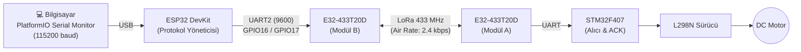

# ESP32 + EBYTE E32 LoRa Güvenilir Motor Kontrol Protokolü

Bu proje, **ESP32** ve **EBYTE E32 LoRa** modülü kullanarak STM32 tarafındaki bir DC motoru uzaktan kontrol etmek ve hattın bağlantı kalitesini ölçmek amacıyla geliştirilmiş **güvenilir bir kablosuz iletişim protokolüdür**.

---

## 🎯 Bu Kod Ne İşe Yarar? Neden Yazıldı?

Standart kablosuz haberleşmelerde tek taraflı komut göndermek ("körlemesine gönderim") şu riskleri barındırır:
1. **Paket kaybolursa haberiniz olmaz:** Parazit nedeniyle komut gitmediğinde motor çalışmaz ama kontrolcü bundan habersizdir.
2. **Paket bozulursa tehlike doğar:** Havadaki manyetik gürültü bir biti değiştirirse motora istenmeyen bir komut gidebilir veya "Dur" komutu çalışmayabilir.
3. **Sinyal performansı bilinemez:** Hatta ne kadar paket kaybı var, sinyal kaç milisaniyede gidip geliyor ölçülemez.

Bu kod, basit bir seri köprü yerine **endüstriyel seviyede el sıkışmalı (handshake)** bir protokol uygular:
* ✅ **Garantili İletişim (ACK):** Her komut gönderildiğinde STM32'den teyit beklenir. Motorun gerçekten ileri/geri döndüğü ya da durduğu doğrulanır.
* 🔄 **Otomatik Tekrar Deneme (Auto-Retry):** Eğer 1000 ms içinde ACK gelmezse komut pes etmeden otomatik olarak tekrar gönderilir (3 denemeye kadar).
* 🛡️ **Veri Bütünlüğü Koruması (CRC8):** Hem komut hem de onay paketleri matematiksel sağlama (CRC8) ile korunur; bozuk paketler anında çöpe atılır.
* 🔢 **Sıra Numarası (Sequence Tracking):** Paketlere benzersiz sıra numarası verilerek eski veya mükerrer paketlerin sistemi yanıltması engellenir.
* 📊 **Canlı Hat Testi ve İstatistik (Ping / Telemetri):** Hatta kaç ms gecikme (RTT) olduğu ve paket kaybı oranı anlık olarak ölçülebilir.

---

## 🏗️ Sistem Mimarisi



---

## 📦 Protokol & Paket Formatı

ESP32 ile STM32 arasındaki tüm paketler **5 bayt sabit uzunluktadır**:

### 1. Komut Paketi (ESP32 ➔ STM32)
`[0xAA] [SEQ] [CMD] [VERI] [CRC8]`

* `0xAA`: Paket başlangıç başlığı (Header).
* `SEQ`: Sıra numarası (Her yeni komutta 1 artar).
* `CMD`: Komut kodu:
  * `0x01`: İleri (`CMD_ILERI`)
  * `0x02`: Geri (`CMD_GERI`)
  * `0x03`: Dur (`CMD_DUR`)
  * `0x04`: Durum Sorgula (`CMD_DURUM`)
* `VERI`: İlave parametre (Şu an `0x00`).
* `CRC8`: `SEQ`, `CMD`, `VERI` (3 bayt) üzerinden polinom `0x07` ile hesaplanan sağlama değeri.

### 2. Onay / ACK Paketi (STM32 ➔ ESP32)
`[0x55] [SEQ] [DURUM_KODU] [MOTOR_DURUMU] [CRC8]`

* `0x55`: ACK başlangıç başlığı.
* `SEQ`: Yanıtlanan komutun sıra numarası.
* `DURUM_KODU`: `0x00` (Başarılı / OK) veya hata kodu.
* `MOTOR_DURUMU`: Motorun anlık durumu (`0`: Duruyor, `1`: İleri, `2`: Geri).
* `CRC8`: STM32 tarafından hesaplanan sağlama baytı.

---

## ⌨️ Serial Monitor Kullanıcı Komutları

Serial Monitor üzerinden (115200 baud hızında) tek harf girip `Enter` tuşuna basarak kullanılır:

| Tuş | Açıklama |
| :---: | :--- |
| **`F`** | Motoru **İLERİ** sürer, STM32'den teyit bekler ve gidiş-dönüş süresini yazar. |
| **`B`** | Motoru **GERİ** sürer, teyit alır. |
| **`S`** | Motoru **DURDURUR**, durduğunu teyit eder. |
| **`D`** | Motor hareketini değiştirmeden STM32'ye **mevcut durumu** sorar. |
| **`T`** | **Bağlantı Testi:** Tekrar denemesi olmaksızın peş peşe 50 paket atarak hattın ham paket kaybını ve gecikmesini test eder. |
| **`I`** | Sistem açıldığından beri toplanan tüm **istatistikleri** gösterir. |
| **`R`** | Tüm istatistik sayaçlarını sıfırlar. |

---

## 🔌 Donanım Bağlantısı (ESP32 ↔ EBYTE E32)

| E32-433T20D Pini | ESP32 DevKit Pini | Not |
| :--- | :--- | :--- |
| **VCC** | **5V / VIN** | USB beslemesinden 5V |
| **GND** | **GND** | Ortak toprak |
| **TXD** | **GPIO16 (RX2)** | Çapraz bağlantı |
| **RXD** | **GPIO17 (TX2)** | Çapraz bağlantı |
| **M0** | **GND** | Normal iletim modu (Boşta bırakmayın) |
| **M1** | **GND** | Normal iletim modu (Boşta bırakmayın) |
| **AUX** | Boşta | İsteğe bağlı izleme |

---

## 📈 Örnek Test Çıktısı ve Değerlendirmesi

Serial Monitor'den `I` veya test bitiminde alınan örnek istatistik tablosu:

```text
------ ISTATISTIK ------
Komut            : 114
Basarili (ACK)   : 114
Basarisiz        : 0
Toplam gonderim  : 114 (tekrar: 0)
Bozuk ACK (CRC)  : 0
Paket kaybi      : %0.0 (gidis veya donus)
Gidis-donus (ms) : ort 467, min 463, max 666
------------------------
```

### Bu Değerler Ne Anlatır?
* **%0.0 Paket Kaybı:** Sinyal seviyesi ortam için mükemmeldir; havada hiçbir paket yitirilmemiştir.
* **Tekrar: 0:** Tüm paketler ilk denemede hedefe ulaşmıştır.
* **Ortalama ~467 ms RTT (Gidiş-Dönüş Süresi):** E32'nin 2.4 kbps hava hızında fiziksel iletim süresi, işlemci süreleri ve UART tamponları ile tam uyumlu, beklenen kararlı süredir.
* **Jitter (Sapma):** Minimum (463 ms) ile Ortalama (467 ms) arasındaki 4 ms'lik fark sistemin son derece stabil çalıştığını kanıtlar.
