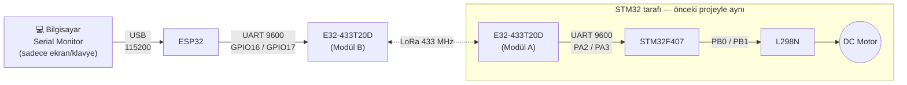

# ESP32 + EBYTE E32 LoRa ile Uzaktan Motor Kontrolü

Bu proje, [**PC-and-stm32-comm-by-LoRa**](../PC-and-stm32-comm-by-LoRa/README.md) projesinin devamıdır. Fark tek bir noktada: **komutları gönderen taraf artık bilgisayar + USB-TTL değil, ESP32.**

**STM32 tarafı (E32 Modül A, STM32F407, L298N, motor), kodu ve bağlantıları ile önceki projeyle birebir aynıdır.** O tarafın bağlantı şeması, CubeMX ayarları ve kodu için önceki projenin README'sine bakın.



| | Önceki proje | Bu proje |
|---|---|---|
| Komut gönderen taraf | Bilgisayar + **USB-TTL** + Docklight | **ESP32** + Arduino Serial Monitor |
| E32 Modül B'nin bağlandığı yer | USB-TTL kablosu | ESP32 (GPIO16/17) |
| STM32 tarafı | E32 A + STM32F407 + L298N + motor | **Değişmedi** |
| Komutlar | `F` / `B` / `S` | **Değişmedi** |
| E32 ayarları | `C0 00 00 1A 17 44` | **Değişmedi** |

---

## 1. Kullanılan malzemeler (ESP32 tarafı)

| Malzeme | Adet | Açıklama |
|---|---|---|
| **ESP32** geliştirme kartı (ESP32 DevKit, WROOM) | 1 | Arduino IDE ile programlanır |
| EBYTE **E32-433T20D** (Modül B) | 1 | Önceki projede USB-TTL'e bağlı olan modül |
| **TX433-JKD** anten | 1 | 433 MHz, SMA |
| Jumper kablolar, breadboard | – | |

STM32 tarafının malzemeleri için önceki projeye bakın.

---

## 2. Bağlantı şeması: ESP32 ↔ E32 (Modül B)

```
        ESP32 DevKit                              E32-433T20D (Modül B)
   ┌──────────────────────┐                     ┌────────────────────┐
   │                5V/VIN├────────────────────►│ VCC                │
   │                   GND├─────────┬──────────►│ GND                │
   │        GPIO17 (TX2)  ├─────────┼──────────►│ RXD                │
   │        GPIO16 (RX2)  │◄────────┼───────────┤ TXD                │
   │                      │         ├──────────►│ M0                 │
   │                      │         └──────────►│ M1                 │
   │   USB                │                     │ AUX        (boş)   │
   └───┬──────────────────┘                     │ [SMA] ── TX433-JKD │
       │                                        └────────────────────┘
   Bilgisayar
 (güç + Serial Monitor)
```

| E32 (Modül B) | ESP32 | Not |
|---|---|---|
| VCC | **5V / VIN** | USB'den gelen 5 V |
| GND | **GND** | Ortak |
| RXD | **GPIO17** (TX2) | Çapraz |
| TXD | **GPIO16** (RX2) | Çapraz |
| M0 | **GND** | Normal mod |
| M1 | **GND** | Normal mod |
| AUX | Boş | |

- ESP32 3,3 V lojik seviyesinde çalışır; E32 ile doğrudan konuşur, **seviye dönüştürücü gerekmez.**
- **WROVER** kartlarda GPIO16/17 PSRAM'e ayrılmıştır. Bu kartlarda **GPIO26 (RX)** ve **GPIO27 (TX)** kullanın ve koddaki `E32_RX` / `E32_TX` değerlerini değiştirin.
- M0/M1 içeride zayıf pull-up'lıdır; **boşta bırakmayın**, mutlaka GND'ye bağlayın.

---

## 3. Arduino IDE kurulumu

1. **File → Preferences → Additional boards manager URLs** alanına ekleyin:
   ```
   https://espressif.github.io/arduino-esp32/package_esp32_index.json
   ```
2. **Tools → Board → Boards Manager** → `esp32` arayın → **esp32 by Espressif Systems**'i kurun.
3. **Tools → Board → ESP32 Dev Module** seçin, ESP32'nin COM portunu seçin.

---

## 4. Kod

ESP32 iki yönlü bir **köprü** gibi çalışır: Serial Monitor'den yazılanı E32'ye, E32'den geleni Serial Monitor'e aktarır.

```cpp
// ESP32 <-> E32-433T20D köprüsü
// Serial Monitor'den yazılanı E32'ye yollar, E32'den geleni ekrana yazar.

#define E32_RX 16   // ESP32 RX2  <- E32 TXD
#define E32_TX 17   // ESP32 TX2  -> E32 RXD

void setup() {
  Serial.begin(115200);                               // bilgisayar (Serial Monitor)
  Serial2.begin(9600, SERIAL_8N1, E32_RX, E32_TX);    // E32
  delay(500);                                         // E32'nin açılışını bekle
  Serial.println("ESP32 hazir. F (ileri), B (geri), S (dur) gonder.");
}

void loop() {
  // Bilgisayardan gelen -> E32 -> STM32
  while (Serial.available()) {
    char c = Serial.read();
    if (c == '\r' || c == '\n') continue;   // satır sonlarını gönderme
    Serial2.write(c);
    Serial.print("[GONDERILDI] ");
    Serial.println(c);
  }

  // STM32 -> E32 -> ESP32 -> ekrana
  while (Serial2.available()) {
    Serial.write(Serial2.read());
  }
}
```

| Seri port | Kime bağlı | Hız |
|---|---|---|
| `Serial` | Bilgisayar (USB) | 115200 |
| `Serial2` | E32 (GPIO16/17) | 9600 8N1 |

---

## 5. Komutlar

Önceki projeyle aynı. Serial Monitor'e yazıp Enter'a basın:

| Komut | Motor | STM32'nin cevabı |
|---|---|---|
| `F` | İleri | `OK ILERI` |
| `B` | Geri | `OK GERI` |
| `S` | Dur | `OK DUR` |
| Başka harf | Değişmez | `HATA: F, B veya S gonder` |

STM32 açılışta bir kez `HAZIR` gönderir.

Örnek Serial Monitor çıktısı:

```
ESP32 hazir. F (ileri), B (geri), S (dur) gonder.
HAZIR
[GONDERILDI] F
OK ILERI
[GONDERILDI] B
OK GERI
[GONDERILDI] S
OK DUR
```

---

## 6. Yükleme ve test

1. **Upload** ile yükleyin. "Connecting..." da takılırsa ESP32'deki **BOOT** düğmesine basılı tutun, yükleme başlayınca bırakın.
2. **Tools → Serial Monitor**, hız **115200**.
3. `ESP32 hazir...` görünmezse ESP32'nin **EN** (reset) düğmesine basın.
4. STM32 tarafını açın (motor güç kaynağı **takılı değilken**). STM32'yi resetlerseniz Serial Monitor'de `HAZIR` görünür.
5. `F`, `B`, `S` gönderip cevapları kontrol edin.
6. Cevaplar doğruysa motor güç kaynağını (7–12 V) takıp motorla deneyin.

> Antenleri enerji vermeden önce takın. İki modül arasında en az 1–2 m mesafe olsun; çok yakında alıcı doyuma girer.

---

## 7. Sorun giderme

| Belirti | Kontrol |
|---|---|
| `[GONDERILDI] F` görünüyor, cevap yok | GPIO17 → E32 RXD, GPIO16 ← E32 TXD (ters olabilir, yer değiştirmek zarar vermez); M0/M1 = 0 V mu; STM32 tarafı açık mı |
| Ekranda anlamsız karakterler | Serial Monitor hızı 115200 değil |
| Ekranda hiçbir şey yok | Yanlış COM portu, ya da ESP32'yi EN ile resetleyin |
| Yükleme başlamıyor | BOOT düğmesine basılı tutarak yükleyin; USB kablosu veri kablosu mu |
| Cevap geliyor, motor dönmüyor | STM32 tarafı: ENA jumper'ı, 12 V besleme, ortak GND (önceki projenin sorun giderme bölümü) |

E32'nin ayar modunda kontrolü (`C3 C3 C3`, `C1 C1 C1`) ve diğer sorunlar için önceki projenin README'sine bakın.

---

## 8. Sonraki adımlar

- **Bilgisayarı tamamen çıkarmak:** komutları ESP32'nin WiFi'ı üzerinden telefondan bir web sayfasıyla, ya da ESP32'ye bağlı butonlarla vermek.
- M0/M1 ve AUX'u ESP32'nin GPIO'larına bağlayıp E32 ayarlarını ESP32'den okumak/yazmak.
- Bağlantı koparsa motoru durduran zaman aşımı.
